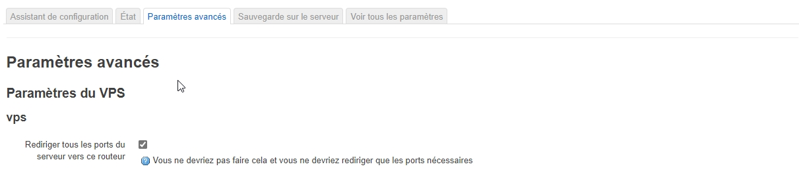
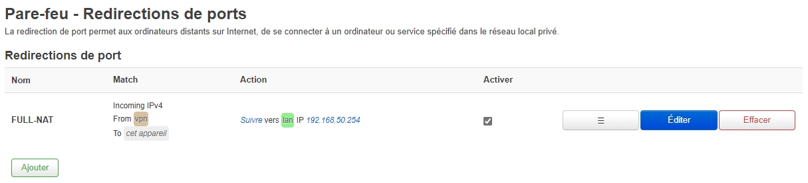
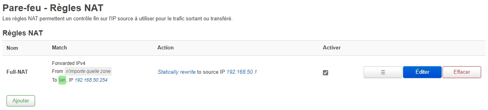

# Open a DMZ in OpenMPTCProuter

> Draft: incomplete screenshot notes for forwarding traffic through an
> OpenMPTCProuter installation.

Open **System > OpenMPTCProuter**.

Open **Network > Firewall**.

