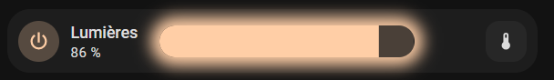

# Build a Mushroom light card with a glowing slider

> Add a color-matched glow to a Home Assistant Mushroom light card while
> keeping brightness and color controls available.



## Prerequisites

- A working Home Assistant installation and dashboard.
- [Mushroom Cards](https://github.com/piitaya/lovelace-mushroom), installed
  through HACS or manually.
- [card-mod](https://github.com/thomasloven/lovelace-card-mod), installed
  through HACS or manually.
- A light entity with brightness and RGB color attributes.

## Steps

1. Add a manual card to a dashboard.
2. Expand the example below and copy the YAML into the card editor.
3. Replace `light.living_room` and `switch.living_room_lights` with entity IDs
   from your installation.
4. Adjust the displayed name and actions to match the target light.
5. Save the card and reload the dashboard.

<details>
<summary>View the YAML configuration</summary>

```yaml
type: custom:mushroom-light-card
entity: light.living_room
show_brightness_control: true
collapsible_controls: false
show_color_control: true
name: Living room lights
fill_container: false
use_light_color: true
show_color_temp_control: true
layout: horizontal
primary_info: name

double_tap_action:
  action: perform-action
  perform_action: switch.turn_on
  target:
    entity_id: switch.living_room_lights

hold_action:
  action: perform-action
  perform_action: switch.turn_off
  target:
    entity_id: switch.living_room_lights

icon: mdi:power

card_mod:
  style:
    mushroom-shape-icon$: |
      .shape:active {
        transform: scale(1.2);
      }
    .: |
      mushroom-light-brightness-control, mushroom-light-color-temp-control,
      mushroom-light-color-control {
        position: absolute;
        margin-left: 2%;
        width: 48%;
        transition: box-shadow 2s ease-in-out;
        --control-height: 2em;
        
        box-shadow: 0 0 0.95rem {{ state_attr('light.living_room','brightness') /255 }}vh #{{ '%02x%02x%02x' | format((state_attr('light.living_room','rgb_color') | list )[0], (state_attr('light.living_room','rgb_color') | list )[1], (state_attr('light.living_room','rgb_color') | list )[2]) }};
        border-radius: var(--ha-card-border-radius, 12px);
        transition: box-shadow 0.5s ease-in-out;
        
        border-radius: var(--ha-card-border-radius, 12px);
        --control-border-radius: var(--ha-card-border-radius, 12px);
      }
      mushroom-state-item {
        z-index: 1;
        max-width: fit-content;
        margin-bottom: 0;
        pointer-events: none;
        border: solid 5px var(--card-mod-icon-color);
      }
      mushroom-shape-icon {
        pointer-events: auto;
      }
      mushroom-button {
        position: absolute;
        width: calc(var(--control-height) * var(--control-button-ratio)) !important;
        height: var(--control-height) !important;
        top: var(--spacing);
        right: var(--spacing);
      }
      mushroom-button:nth-child(3) {
        right: calc(2 * var(--spacing) + var(--control-height) * var(--control-button-ratio));
      }
      .actions :not(:last-child) {
        margin-right: 0 !important;
      }
```

</details>

The template reads the light brightness and RGB values to generate the glow.
Double-tap and hold actions control the separate switch entity. Remove those
actions when the light does not need a companion switch.

## Verify

- The light toggles normally when the card is tapped.
- Brightness and color controls remain usable.
- The glow appears only while the light is on and follows its selected color.
- Double-tap and hold control the intended switch, if those actions are kept.

Animated shadows can be expensive on low-power dashboard devices. Test the
dashboard after adding several glowing cards and reduce animations if scrolling
or updates become slow.

## References

- [Home Assistant dashboard documentation](https://www.home-assistant.io/dashboards/)
- [Mushroom Cards repository](https://github.com/piitaya/lovelace-mushroom)
- [card-mod repository](https://github.com/thomasloven/lovelace-card-mod)
